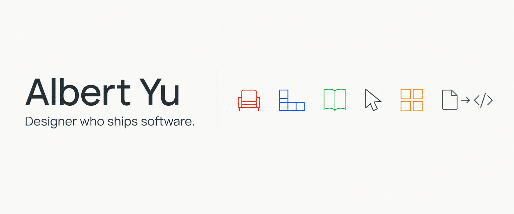

# Hi, I'm Albert

**Toronto** | **Designer who ships software** | **Brand, marketing and the tools behind them**

I started in industrial design and 3D visualization, moved into brand and marketing at an AI infrastructure startup, and now spend most of my time building the software that marketing runs on: websites, ad tooling, and automated demo and image pipelines. I work with AI coding agents every day and design my projects so they can help.

## Projects

### Web and infrastructure

- 🧭 **[webflow-to-astro](https://github.com/albertyu647/webflow-to-astro)** - how I moved a production marketing site with a live CMS off Webflow and onto Astro + Cloudflare, with pixel-parity testing
- 🎟️ **[Seat Alerts](https://github.com/albertyu647/seat-alerts-ca)** - get an email the moment the movie seats you want open up; Cloudflare Workers + D1 ([live](https://cineplex-notifier.ca))
- 📖 **[Bible Memo](https://github.com/albertyu647/bible-memo)** - offline-first bilingual Bible reader and memorization app ([open the app](https://bible-memo.pages.dev))

### AI agent tools

- 🗝️ **[aria-browser](https://github.com/albertyu647/aria-browser)** - lets any AI coding agent read and click through sites you're signed in to, in a headless Chrome that never opens a window; installs as an agent skill

### Marketing tools

- 🎯 **[linkedin-ads-manager](https://github.com/albertyu647/linkedin-ads-manager)** - bulk-edit targeting, bids and budgets across LinkedIn campaigns
- 🖼️ **[gemini-bulk-image-generator](https://github.com/albertyu647/gemini-bulk-image-generator)** - paste a document of prompts, get a ZIP of images from Gemini or OpenAI
- 🎧 **[spotify-playlist-finder](https://github.com/albertyu647/spotify-playlist-finder)** - find playlists that already contain a set of songs

### Video and demos

- 🎬 **[autodemo](https://github.com/albertyu647/autodemo)** - script a product demo as clicks and keystrokes, get a polished screen recording with no recording session
- 🔍 **[openscreen](https://github.com/albertyu647/openscreen)** - OpenScreen fork with steadier zooms and headless export

### Games

- 🕹️ **[Neo-Tetris](https://github.com/albertyu647/neo-tetris)** - real-time 1v1 Tetris with garbage lines, LAN and online play, and a bot ([play now](https://neo-tetris.pages.dev))

### Case studies

- 📟 **[textnow-cli](https://github.com/albertyu647/textnow-cli)** - unofficial, educational: reverse-engineering a web messaging client into a terminal app and an SMS chatbot

## Background

Brand and marketing at an enterprise AI company (2022 to now) · 3D visual artist at Umbra · Brand designer at Tazwiz · Industrial design at A-Light · Carleton University

## Elsewhere

[LinkedIn](https://www.linkedin.com/in/albert-yu-ca/)
